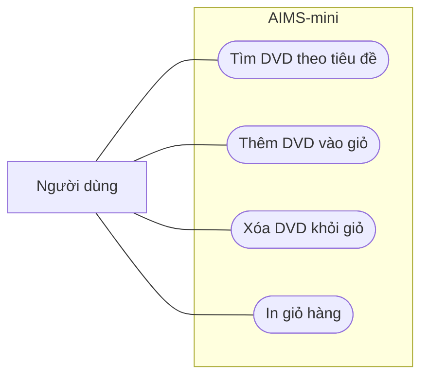

# Use case AIMS-mini

**Tác nhân chính:** Người dùng tìm DVD và quản lý giỏ hàng.

| Use case | Thao tác của người dùng | Kết quả |
| --- | --- | --- |
| Tìm DVD theo tiêu đề | Nhập từ khóa để tìm trong danh sách DVD. | Trả về các DVD có tiêu đề chứa từ khóa, phân biệt chữ hoa và chữ thường. |
| Thêm DVD vào giỏ | Chọn DVD muốn thêm. | Nếu thêm thành công, DVD xuất hiện trong giỏ. |
| Xóa DVD khỏi giỏ | Chọn DVD muốn xóa. | DVD được xóa nếu có trong giỏ. Nếu không tìm thấy, chương trình báo `The disc is not in the cart`. |
| In giỏ hàng | Yêu cầu xem nội dung giỏ. | In số thứ tự, tiêu đề, giá từng DVD và tổng tiền. Nếu giỏ trống, in `The cart is empty`. |

`main.py` minh họa luồng thêm ba DVD rồi in giỏ. Các thao tác xóa và tìm kiếm được cung cấp qua các hàm Python.
